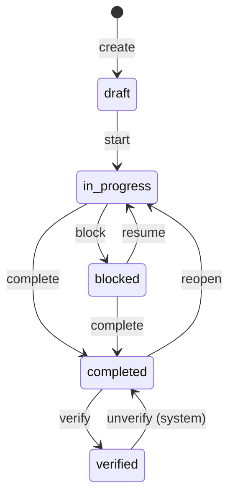

An action plan is a promise to fix something: the work, who owns it and
when it is due. It links to the risks it reduces and the controls it
puts right, so you can show not just what is wrong but what is being
done about it. A risk treated by mitigation can point to a plan.

## How a plan moves

A plan starts as a draft, goes in progress, may be blocked for a while,
and is marked completed when its owner says the work is done. Completed
is a claim, not proof. Verified means the work is shown to have closed
the gap, and how a plan gets there depends on its links:

- **With linked controls**, the platform decides. After each control
  evaluation, a completed plan whose linked controls all pass becomes
  verified. If one of them stops passing, the plan goes back to
  completed by itself. Excepted is not a pass. No person makes either
  move.
- **With no linked controls**, an admin verifies it by hand. The plan's
  owner never can, even when self-approval is on.

A completed plan can also be reopened to in progress when the gap is
still there.

## What this page shows

Every action plan, with its owner, due date, status and links. Filter by
status. Open a plan to work on it: its page says when a completed plan's
linked controls are not all passing yet.

## Who can do what

- **See** action plans: admins and GRC engineers.
- **Create, edit, move and verify** plans: admins. A plan with linked
  controls is verified only by its controls' evaluations.
