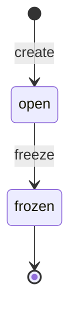

An audit period is the window of time an external auditor reviews for one
framework, such as SOC 2 for the first half of the year. It names the
framework version and a start and end date. A SOC 2 and an ISO 27001 audit
over the same months are two periods.

## Freezing

A period starts open. While it is open, the evidence it can draw on keeps
growing as new evidence arrives. When fieldwork starts, an admin freezes
it. From then on its sample populations hold only evidence observed up to
the moment of freezing, and the period records who froze it, when, and a
fingerprint of what was frozen. Freezing is final: a frozen period can't
be unfrozen or edited. Your live programme carries on as normal; only the
audit's view stops moving.

## How the auditor works

An admin assigns auditors on the period's page; each must hold the auditor
role. An assigned auditor sees that period's populations and samples, and
the evidence in them, and can draw samples and leave notes. They can't
freeze the period or change your controls.

A population is one control's evidence over a window. A sample is a set
number of records drawn from it with a seed, so the same seed always
picks the same records and nobody can hand-pick them.

## Common tasks

- **New audit period**: name it, pick the framework version, set the dates.
- **Open a period** to see each control's observations and latest result,
  and open a control to work its populations and samples.
- **Export OSCAL bundle** from a frozen period: the signed set of files an
  auditor's tools can read.

## Who can do this

Admins create and freeze periods and assign auditors. GRC engineers can
see periods and build populations and samples. Assigned auditors work only
in their own periods.
