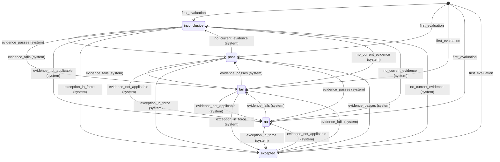

A control is one thing your organisation does to stay secure, such as
"every account signs in with multi-factor authentication". You write each
control once. Frameworks such as SOC 2 and ISO 27001 take credit from it
through its SCF anchor, so one control can satisfy requirements in several
frameworks without being copied for each.

## What this page shows

The **View** filter switches between two lists:

- **My controls** lists your organisation's controls, each with its
  current state and how fresh its evidence is.
- **SCF catalog** lists the controls of the Secure Controls Framework
  (SCF), with the controls you have mapped to each one. Filter it to
  **No control** to find gaps: an SCF control with nothing mapped to it
  earns no framework credit.

## How a control gets its state

A control's state comes from its evidence, not from how the control is
described. Each evaluation reads the evidence that is still fresh and
works out a result:

- **pass** when the current evidence passes;
- **fail** when any current automated check fails, or the latest
  attestation says it failed;
- **na** when every current record says the control does not apply;
- **inconclusive** when there is no current evidence, because none has
  arrived or it has gone stale. That is not the same as failing;
- **excepted** when an active exception covers that part of your scope,
  whatever the evidence says. Excepted is never a pass.

Any result can follow any other: each evaluation starts afresh, as the
diagram shows. Evaluation never changes the evidence.

## Who can do what

- **Attest** to a manual control: someone holding the control's owner
  role, or an admin. Choose pass or fail (a fail needs a reason). The
  latest attestation wins, and one dated in the future is refused.
- **Evaluate now**: the control's assigned owner, or an admin. Each
  person can run it a few times a minute.
- **Download** a control's definition as a bundle: anyone who can see
  the control. **Uploading** a new version is for admins.
- **Request an exception** from a control's page: GRC engineers and
  admins.
