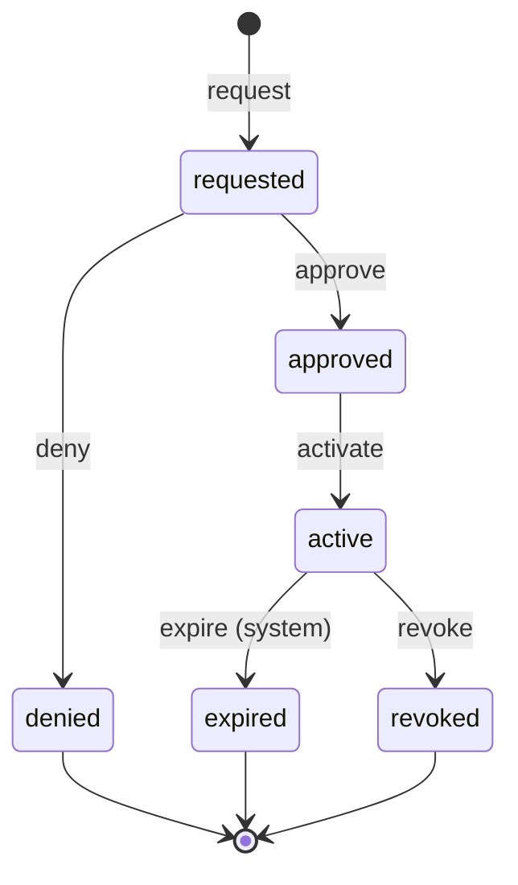

Sometimes a control cannot be met for a while: a legacy system that
cannot take multi-factor sign-in until it is replaced, say. An exception
records that decision openly instead of leaving a failing control
unexplained. It names the control, the part of your scope it covers, the
reason, and an end date no more than a year away. It never renews by
itself.

## How an exception works

Someone asks for it, an approver approves or denies it, and an approved
exception takes effect once it is activated. It ends when its end date
passes, which happens automatically, or when an approver revokes it
early. Every step is logged.

While an exception is active, the control shows **Excepted** wherever
the exception applies, whatever its evidence says. Excepted is never a
pass. A framework's posture still counts the control as covered, but
shows separately how much of the framework rests only on exceptions.
Starting an exception, ending it by expiry, or revoking it re-evaluates
the control straight away, so its state changes then.

## What this page shows

Every exception in your organisation, with its control, state, reason
and dates. The list is read-only: open an exception to act on it, or
export the list as CSV, JSON or a spreadsheet.

## Who can do what

- **Request** an exception, from the control's page: GRC engineers and
  admins.
- **Approve, deny, activate or revoke**: approvers, which means admins
  and GRC engineers. The approver must be a different person from the
  requester, unless an admin has turned on self-approval; a self-approved
  exception is marked as such. Nobody can deny their own request, and
  only a person approves, denies, activates or revokes, never an API key.
