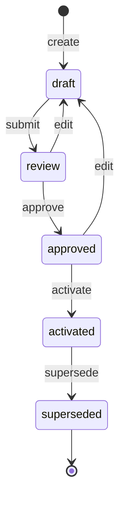

A framework scope says which parts of your organisation a framework
applies to. PCI DSS might cover only the systems that handle card data,
while SOC 2 covers the whole product. A control counts towards a framework
only where the control applies and the framework's scope applies. A
framework with no activated scope shows "Scope not set" instead of a
posture.

## Revisions

A scope is kept as revisions, so you can always see which scope was in
force on a given date. **New scope** walks you through picking the
framework version, the business units, environments, regions and other
dimensions it covers (or everything), and a name; it is then submitted
for approval. A second person approves it, and it is then activated from
a date and time you choose. Activating a revision supersedes the one
before it.

Changing a revision that is in review or approved sends it back to draft,
and its approval is cleared. Activated and superseded revisions are
frozen: to change one, start a **New revision** from it.

## Statement of Applicability

The second tab records a decision for each of the framework's
requirements: applicable, or excluded with a justification. Requirements
with no decision count as applicable, and excluded ones don't count
against the framework's posture. If you exclude a requirement that a
passing control sits behind, it is flagged as a contradiction so you can
check the exclusion. You can decide rows one at a time or in bulk, import
decisions from CSV, and export the statement as CSV or xlsx. Its
decisions are approved and activated with the revision.

## Who can do this

Admins and GRC engineers create, edit, submit and activate scopes.
Approving needs someone with the approver right who isn't the person who
submitted it, unless your organisation allows self-approval. Only a
person approves, never an API key. Viewers, control owners and auditors
can read scopes.
