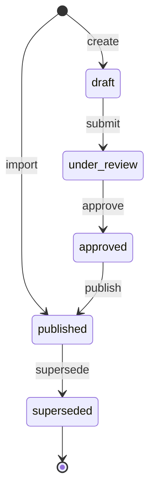

A policy is a written rule your organisation commits to, such as how
access is granted or how incidents are handled. Auditors read your
policies to check that what you do matches what you say. Each policy
names the role that owns it, the role that approves it, the controls it
backs, and the roles that must read it.

## Versions and approval

A policy is written as a draft, then submitted for review. While it is
under review its text is fixed; an approver approves it, and then
publishes it with an effective date and a next review date. A policy
must link at least one control before it can be published. To change a
published policy, start **Create new version**: the new version goes
through the same review, and publishing it supersedes the old one, which
stays readable as history. A draft you no longer want can be discarded.
An admin can also import an existing policy straight to published.

## Acknowledgments

The people in a policy's acknowledgment roles confirm they have read its
published version. An acknowledgment counts for one version and lasts a
year, so a new version or the passing of a year asks them again. The
list shows each policy's acknowledgment rate, and you can filter for
policies below 95% or past their review date.

## Who can do this

Admins and GRC engineers write, submit, discard, approve and publish
policies. The approver must be a person other than the one who submitted
the policy or edited its draft, unless your organisation allows
self-approval. Everyone else can read policies.
