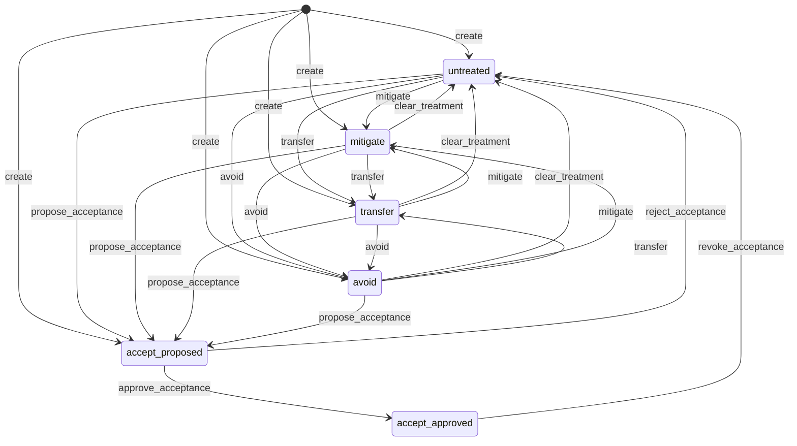
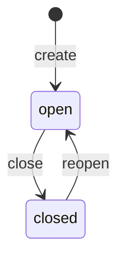

A risk is something that could go wrong and hurt your organisation: a
key supplier failing, customer data leaking, a critical system with no
backup. The risk register is your list of them, so you can decide what
to do about each one and show that you did.

## How a risk is scored

Most risks use a 5×5 grid. Likelihood and impact are each scored 1 to
5, and their product is the inherent severity: Low (1–7), Medium (8–14)
or High (15–25). The residual risk is what is left once your linked
controls are counted. It comes down only as their evidence passes.

A risk can use FAIR instead, which estimates the loss you can expect in
dollars a year. FAIR values are shown in dollars and never put into the
Low, Medium or High bands. If you choose **Score later**, the risk is
logged unscored. When you sort by severity, unscored risks come last,
after the FAIR ones.

Changing a risk's methodology resets its residual, because a score on
one scale does not read on the other; the old residual stays in the
risk's history. If someone else saves a risk while you are editing it,
your changes are not saved over theirs: reload to see the latest
version, then make your changes again.

## Deciding what to do

Every risk needs a treatment. Mitigate needs a linked control or action
plan, and transfer needs a reference such as an insurance policy.
Accepting a risk takes two steps: someone proposes it with a
justification and an end date, then an approver approves or rejects it.
An approved acceptance can be revoked, which leaves the risk untreated.

A risk that no longer applies is closed with a reason: not applicable,
merged into another risk, or realised and handled. A closed risk leaves
the register's default view, heatmaps, roll-ups and board packs, keeps
its history, and can be reopened.

## What this page shows

Your open risks, filtered, sorted and paged by the server, so the counts
cover the whole register. Filter by status, owner, treatment, category,
review date, methodology or org unit. Roll-ups stay hidden until you
turn on **Show roll-ups**, so nothing is counted twice. Export the list
as CSV, JSON or a spreadsheet. **Risk taxonomy** holds your categories
and themes.

## Who can do what

- **Create, edit, treat, close and reopen** a risk, and **propose** an
  acceptance: admins and GRC engineers.
- **Approve, reject or revoke** an acceptance: approvers, which means
  admins and GRC engineers. The approver must be someone other than the
  proposer, unless an admin has turned on self-approval, and only a
  person approves, never an API key.
- **Delete** a risk for good: admins only. Everyone else closes it.
- **Edit categories and themes**: admins and GRC engineers.
